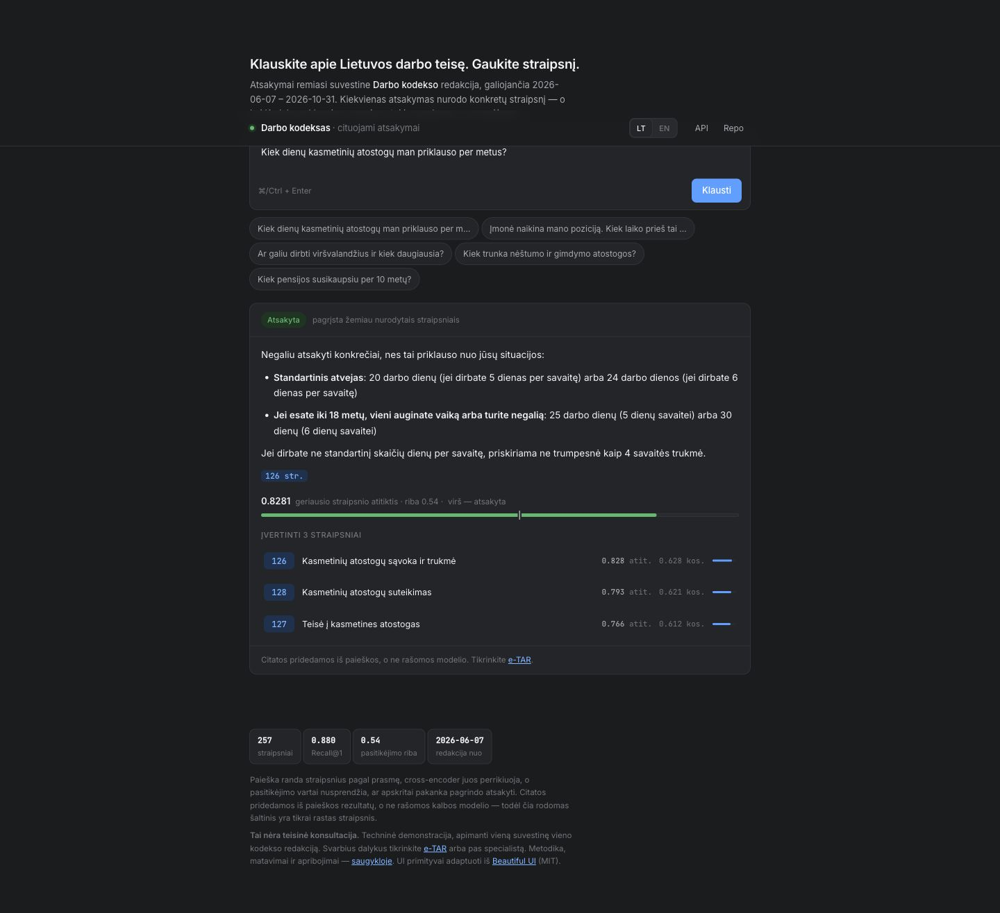
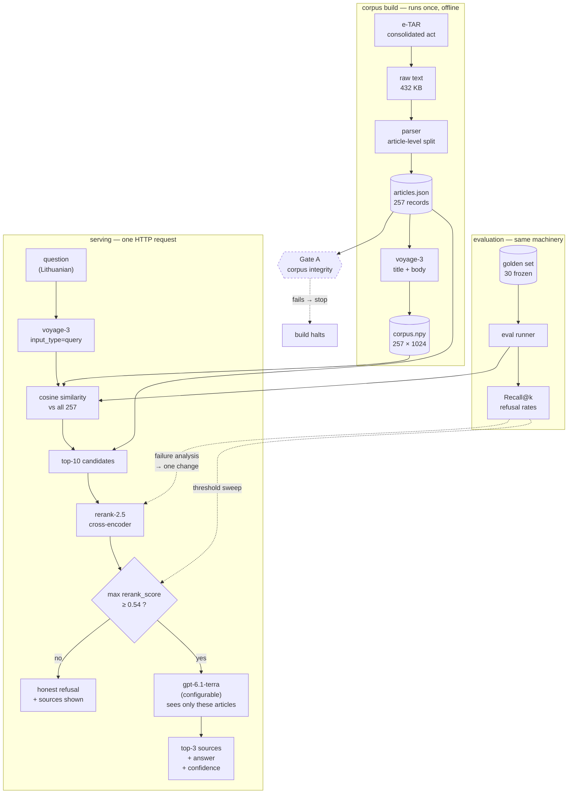

# Lithuanian Labour Code RAG

[](https://github.com/dziugasmarcenas-ui/legal-rag/actions/workflows/ci.yml)

**A deployed retrieval-augmented assistant that answers Lithuanian employment-law
questions from 257 primary-source Labour Code articles, cites the governing article,
and refuses when the available text is not sufficient.**

[Try the live application](https://legal-rag-production-fac6.up.railway.app) ·
[Read the case study](docs/portfolio/CASE_STUDY.md) ·
[Use the demo guide](docs/portfolio/DEMO.md) ·
[Reuse the application copy](docs/portfolio/APPLICATION_BULLETS.md)



> **Status: V1 shipped.** Public FastAPI application, bilingual interface,
> versioned corpus, frozen evaluation set, CI checks, Docker image, and measured
> retrieval improvement. This is an information-retrieval demonstration, not
> legal advice.

## For reviewers: where to start

This repository includes the application, its evaluation data, and the checks used to validate changes. A useful short review path is:

1. [Case study](docs/portfolio/CASE_STUDY.md) — scope, decisions, failure analysis and what was measured.
2. [Evaluation code and data](eval/) — inspect the frozen questions and retrieval metrics behind the reported result.
3. [Retrieval implementation](retrieval.py) and [confidence gate](gate.py) — follow how a question becomes evidence or a refusal.
4. [Automated checks](.github/workflows/ci.yml) — see which claims are enforced in CI.

Run the checks locally without model API keys (Python 3.12):

```bash
python -m pip install -r requirements.txt pytest
PYTHONPATH=.:eval python -m pytest tests/ -q
python check_corpus.py
python check_goldenset.py
```

The 0.72 → 0.88 Recall@1 result comes from **25 answerable questions** in a frozen 30-question set, not a production-scale benchmark. The abstention threshold was selected on that same set; its refusal metrics are **not held-out estimates**. Details and unresolved failures are documented below.

## Results at a glance

| Evidence | V1 result |
|---|---|
| Source coverage | 257 articles from one pinned consolidated edition |
| Recall@1 | 0.720 → **0.880** after reranking |
| Recall@3 | 0.840 → **0.920** after reranking |
| Recall@5 control | 0.920 → 0.920, as expected for reordering only |
| Served pipeline | reranks 10 candidates, shows 3: **0.920** top-1, **0.960** in top 3 |
| Abstention | Confidence gate returns an explicit refusal below 0.54 |
| Citations | article **and part** (`126 str. 2 d.`), attached by the retriever, never written by the model |
| Time travel | **41 archived editions** (2017-07-01 → present), `get_article(as_of_date)` |
| Delivery | FastAPI, Docker, Railway, GitHub Actions, LT/EN interface |

## What I built

I scoped the product, replaced a misleading five-document prototype with the
versioned primary-source corpus, implemented retrieval and evaluation, froze and
verified the benchmark before tuning, diagnosed ranking failures, introduced a
cross-encoder reranker, added confidence-based abstention, built the API and
interface, and deployed the container publicly.

The useful result is not only the metric increase. The evaluation separates
candidate-generation, ranking, answerability, and generation failures, so the
remaining limitations are visible rather than hidden behind a polished demo.

## Stack

Python 3.12 · FastAPI · MCP · Voyage embeddings and reranking · OpenAI generation ·
NumPy · pytest · Docker · Railway · GitHub Actions

## Portfolio material

- [Case study](docs/portfolio/CASE_STUDY.md) — decisions, ownership, evidence, and lessons
- [Demo and interview guide](docs/portfolio/DEMO.md) — 90-second and four-minute walkthroughs
- [Application bullets](docs/portfolio/APPLICATION_BULLETS.md) — CV, LinkedIn, and role-specific copy

---

## V1 scope and delivery record

The original scope was frozen on 2026-08-20 before the measured build began.

### Original requirements — completed

- [x] Corpus: consolidated Darbo kodeksas (XII-2603), parsed to article-level records
      carrying `article`, `title`, `text`, `source`, `act_number`, `edition_from`, `edition_to`
- [x] Article-level chunking, embeddings persisted to disk (re-runs do not re-embed)
- [x] Top-k dense retrieval, inspectable with zero LLM calls
- [x] Confidence gate that abstains rather than guessing
- [x] `POST /chat` and `GET /health` over HTTP, publicly deployed
- [x] A golden set of 30 questions (~5 unanswerable), each expected article
      manually verified, **frozen before any tuning**
- [x] Two separate benchmarks: retrieval quality and abstention behaviour
- [x] One measured baseline, one diagnosed failure, one justified fix, one rerun

### Post-scope additions

A browser interface, LT/EN presentation, API rate limiting, and cross-encoder
reranking were added after the measurable core was complete. Reranking was added
only after baseline failure analysis showed that candidate ordering—not corpus
coverage—was the dominant measured problem.

### Still out of scope

- Legal advice or a substitute for a qualified professional
- Case law, ministerial regulations, collective agreements, or other codes
- Unmeasured agentic retrieval or workflow orchestration

---

## Corpus

| Field | Value |
|---|---|
| Source | *Lietuvos Respublikos darbo kodeksas* |
| Approving act | XII-2603 (the Code is annexed to it, not identical to it) |
| Published | TAR 2016-09-19, i. k. 2016-23709 |
| Consolidated edition valid from | **2026-06-07** |
| Consolidated edition valid to | **2026-10-31** |
| Live | https://legal-rag-production-fac6.up.railway.app |
| Retrieved from | e-TAR, act id `f6d686707e7011e6b969d7ae07280e89`, retrieved 2026-08-20 |
| Articles parsed | **257** |
| Parts (dalis) parsed | **997**, cited as `126 str. 2 d.` |
| Editions archived | **41** consolidated editions, 2017-07-01 → present |
| Coverage | Complete Code, all four parts. Articles 1-260, less repealed 85-88, plus 72¹ |

The system answers against **that specific consolidated edition**, not against
"Lithuanian law" generically. When the law changes, the benchmark below becomes
a measurement of a historical edition — which is why the edition is pinned here.

The edition is also checked at runtime. `/health` reports `edition_expired` and
`edition_days_left`, the process logs a warning at boot once the window closes,
and the interface shows a banner. An expired edition is the one failure the
reader cannot see in the output: the retrieved article looks right because it
is the article that was loaded.

**Refreshing it is one command.** `refresh_corpus.py` reads the current edition
token from the e-TAR page, downloads the DOCX of the consolidated text, extracts
paragraphs, and prints the edition window plus the paragraphs that changed:

```bash
python refresh_corpus.py           # fetch and diff, write nothing
python refresh_corpus.py --write   # replace data/darbo_kodeksas_raw.txt
python parse_corpus.py && python check_corpus.py && python embed_corpus.py
python eval/run_eval.py --refresh  # only if the text actually changed
```

The diff is whitespace-insensitive, because e-TAR uses non-breaking spaces for
alignment and those must not trigger a re-embed. Run against the loaded edition
on 2026-10-30, it reports *no substantive change* — the refresh path is verified
against the corpus it is meant to replace.

---

## Architecture



**Citations are attached, not generated.** The `sources` list is built in Python
from the article IDs the retriever returned, before the model is called. If the
model hallucinated an article number in its prose, `sources` would still show
what was actually retrieved.

**Evaluation invokes the same retrieval path the API serves** — not a parallel
copy — so a measured number describes the deployed system.

---

## Chunking rationale

**One record per article. No text splitter, no overlap, no fixed token window.**

Most RAG systems chunk prose with a recursive character splitter because prose
has no natural boundaries. Statute is the opposite: a legislature has already
divided the text into self-contained, individually-citable units. Article 57 is a
complete thought *by design* — that is what makes it citable in court. The
document's own structure is therefore the chunking strategy.

Three consequences:

1. **Citations become structural.** The article number comes from a parsed
   header, never from a model's judgement about where a passage began.
2. **No chunk straddles two provisions**, so an answer cannot be assembled from
   half of one rule and half of another.
3. **Size varies enormously** — 172 to 8,651 characters — and that is correct.
   The largest article is ~2,900 tokens against `voyage-3`'s 32k context, so
   nothing is truncated. A fixed 512-token window would have split article 57
   mid-provision.

The cost: a long article dilutes its own embedding, because one vector must
represent every subsection. Article 126 covers both the definition of annual
leave and its duration; a question about only one of those competes against the
other for the same vector. That is a real limitation of article-level chunking
and the honest counter-argument to the choice above.

---

## Results

### Stage gates

All four passed. A failing gate means stop and fix, not proceed.

| Gate | Covers | Enforced by | Status |
|---|---|---|---|
| **A** | corpus integrity | `check_corpus.py`, in CI | ✅ |
| **B** | retrieval inspectable with no LLM call | manual | ✅ |
| **C** | golden set verified and frozen | `check_goldenset.py`, in CI | ✅ |
| **D** | deployment answers from another machine | `GET /health` from Anthropic infra; `POST /chat` from an iPhone on cellular with wifi disabled | ✅ |

Gate D deliberately required a non-laptop client. `POST /chat` from the phone
returned `refused: false`, `confidence: 0.8359`, and article **126** ranked first
— exercising Railway routing, request validation, the loaded corpus, both API
credentials, embedding, retrieval, reranking, the confidence gate, generation and
source attachment in one request.

### Retrieval benchmark

Answerable questions only. Measures whether the correct article appears in the
top-k retrieved results — independent of whether the language model then writes
a good answer. Retrieval failure and generation failure are different bugs and
are measured separately here on purpose.

| Metric | Baseline | After fix |
|---|---|---|
| Recall@1 | 0.720 (18/25) | **0.880** (22/25) |
| Recall@3 | 0.840 (21/25) | **0.920** (23/25) |
| Recall@5 | 0.920 (23/25) | 0.920 (23/25) |

### Explicit article references

"126 straipsnis" is not a search problem. Embedding it returns articles about
numbers and procedures — measured: `126 straipsnis` returned 26, 198, 247. A
reference pattern now pulls the named article in directly and pins it first;
the reranker still scores everything, so the confidence gate stays honest and
the response says which article was named (`referenced`). None of the frozen
questions names an article, so no published number depends on this.

### What we tried and rejected

**Hybrid lexical retrieval.** BM25 over the same text, fused with vector
candidates, measured on the frozen set: recall@1 **0.88** against the served
0.92, recall@3 0.92 against 0.96. Fusing displaced good semantic candidates.
Unioning instead of fusing (all vector candidates plus five lexical extras) was
neutral at 0.92/0.96 and cost five extra reranked documents, so it was not
shipped. The code and the experiment are in `lexical.py` and
`eval/hybrid_experiment.py`; the negative result is the reason it is not in the
serving path.

### Served configuration


The table above measures candidate generation over the top 5 by cosine
similarity. The application does something a little different, and now does it
deliberately: it pulls **10** candidates, reranks all ten, and shows **3**.
Earlier, `main.py` retrieved 3 and reranked only those, so the deployed product
was not the thing the benchmark measured -- reranking can only reorder what it
is given.

`eval/serving_eval.py` calls `retrieval.retrieve()` with no arguments, the same
call `main.py` makes, so the two cannot drift silently.

| Served metric | Result |
|---|---|
| Top-1 is the correct article | **0.920** (23/25) |
| Correct article in the 3 shown | **0.960** (24/25) |
| False refusal (answerable) | 0.000 (0/25) |
| Correct refusal (unanswerable) | 0.800 (4/5) |

Showing three ranked articles rather than one is deliberate: the articles are
evidence, and the reader is better served by the governing article plus its
neighbours than by a single result the reranker was confident about.

### The one change, and why it was that one

Failure analysis over the seven Recall@1 failures found a dominant pattern:
**mechanism-first retrieval**. The embedding reliably reaches the right legal
neighbourhood but underweights the qualifier that decides which article inside it
governs -- who is acting, why, which subtype. Article 64 (*notice, generally*)
outranked article 57 (*redundancy*); article 147 (*late wage payment*) outranked
both article 130 (*holiday pay*) and the dispute-resolution articles.

Recall@1 0.720 against Recall@5 0.920 pointed the same way: candidate generation
is strong, ordering is weak.

So exactly one thing changed -- **the same five candidates were reordered by a
cross-encoder reranker** (`voyage rerank-2.5`). The corpus, chunking, embeddings,
golden set and its labels were untouched, and the candidates were taken from the
cached baseline retrieval rather than re-retrieved.

`Recall@5` acts as the experiment's control: reordering five items cannot change
whether the correct article is among them. It held at 0.920, so nothing else
leaked in.

Four questions improved (ranks 4→1, 4→1, 2→1, 3→1), none regressed. Two questions
did **not** improve -- their correct articles were never in the candidate set, and
a reranker cannot retrieve what retrieval missed. That limit is the useful part of
the result: it separates a ranking failure from a candidate-generation failure
with evidence rather than assertion.

### Abstention benchmark

Run over both answerable and unanswerable questions.

| Metric | Baseline | After fix |
|---|---|---|
| Unanswerable correctly refused | 0.800 (4/5) | **0.800** (4/5) |
| Answerable falsely refused | 0.720 (18/25) | **0.000** (0/25) |

> The abstention benchmark is **exploratory**: the golden set contains only
> ~5 unanswerable questions. Sample size is stated so the number is not
> mistaken for a reliable rate.

### Confidence threshold

The abstention signal was changed, not just retuned. Both candidates were swept
against the same frozen set.

| Signal | Best threshold | Unanswerable refused | Answerable falsely refused |
|---|---|---|---|
| Cosine similarity | 0.40 | 0.600 (3/5) | 0.080 (2/25) |
| **Cross-encoder relevance** | **0.54** | **0.800 (4/5)** | **0.000 (0/25)** |

Cosine could not separate the two sets at all -- answerable questions scored
0.3573&ndash;0.5627 and unanswerable ones 0.3246&ndash;0.6050, overlapping completely.
Reranker relevance leaves a gap: every answerable question scores at least
**0.5938**, and four of five unanswerable ones score at most **0.4902**. The
operating point is the midpoint of that gap (~0.05 margin either side) rather
than an edge value.

Reranker relevance is **not** a calibrated probability. It is a different score
on a different scale, evaluated empirically here rather than assumed to mean
anything in particular.

**Chosen operating point: 0.54 on cross-encoder relevance.**

**The one unanswerable question that defeats both signals is instructive.** q30
asks what form a court claim must take, which documents to attach and how to
file it electronically. The reranker scores article 231 (*Darbo ginčo
nagrinėjimas teisme*) at **0.8008** -- and it is right that the article is
relevant, because 231 governs taking a dispute to court. What it cannot know is
that 231 explicitly delegates procedure to the Code of Civil Procedure. The
retrieved article is topically correct and still does not contain the answer.
**Relevance and answerability are different questions**, and no relevance
threshold closes that gap.

**Honest limitation.** The threshold was selected on the same 30-question set the
result is reported against, so 0.000 false refusal is an **in-sample** figure,
not a held-out estimate. With only five unanswerable questions, the abstention
result is exploratory. A held-out set of unanswerable questions is the first
thing to add next.

## Methodology and integrity notes

- The golden set was frozen **before** any tuning. Any change made to it after
  the freeze is recorded here, with the reason.
- Post-freeze golden set changes: *none yet.*
- Corpus caveat: e-TAR text extraction flattens superscript article numbers, so
  article 72¹ arrives as `721`. It is caught because 721 falls outside the valid
  range 1-260 and is remapped. A superscript article whose flattened form
  collided with a real article number (12¹ rendering as `121`) would be
  undetectable from this text alone. No such collision exists in this edition -
  article IDs were checked for duplicates and none were found.
- Every expected-article label in the golden set was verified by hand against the
  source document, not generated by a model.
- Continuous integration runs on every push: metric unit tests, Gate A (corpus
  integrity) and Gate C (golden set frozen and unchanged). Both gate scripts exit
  non-zero on failure, so a broken corpus or an edited benchmark fails the build
  rather than being noticed later.
- Corpus verification (Gate A): all automated checks in `check_corpus.py` pass --
  unique IDs, no empty text, no amendment annotations or structural headers
  leaking into article bodies, numbering reconciled, edition dates on every
  record. Of the ten-article manual sample, article 174 was verified in full
  against e-TAR line by line; the remaining nine were checked at title and
  opening-line level.

---

## Honest history

Version 1 of this project ran retrieval over **five hand-written English
paraphrases** of Lithuanian labour law, used top-1 retrieval, had one hardcoded
question, and used a `0.5` confidence threshold picked arbitrarily.

Recall@3 over five documents is trivially near-perfect, which made retrieval look
far better than it was. Preparing the project for real evaluation made clear that
it was not a meaningful benchmark. It was replaced with the actual consolidated
Labour Code, and a manually verified golden set was frozen before anything was
tuned.

The v1 prototype is preserved in this repository's first commit.

---

## Limitations

**Diacritics.** Retrieval is sensitive to missing Lithuanian diacritics, and the
golden set cannot detect this because it is written in correct orthography.
Measured directly:

| Question | With diacritics | Without |
|---|---|---|
| dismissal notice | 64 (0.81), **57** (0.79), 59 (0.75) | 64 (0.66), 36 (0.53), 41 (0.36) |
| maternity leave | **132** (0.94), 133 (0.66) | **132** (0.91), 133 (0.68) |

`nestumo` still resolves to `nėštumo`, but `ispeti` and `pozicija` together are
enough to lose article 57 entirely. Real users type without diacritics often.
The fix (normalising both corpus and query, or indexing both forms) is a second
retrieval change and was deliberately not made inside the one-change experiment.

**The abstention threshold is in-sample.** It was chosen on the same 30 questions
it is reported against, and there are only five unanswerable ones. A de-accented
query outside that distribution was answered at 0.578, just over the 0.54 gate,
on retrieval that had already gone wrong -- the generation step refused it
anyway (`atsakymo į jūsų klausimą nėra`), which is defence in depth rather than a
working gate.

**Two retrieval failures remain.** q17 (employee-initiated resignation) and q23
(return from childcare leave) never place the correct article in the top five, so
reranking cannot reach them. These are candidate-generation failures and would
need a different intervention.

**Relevance is not answerability.** q30 asks about civil-procedure filing
requirements; the reranker correctly scores article 231 highly because 231 does
govern taking a dispute to court, but 231 delegates procedure to the CPK. No
relevance threshold distinguishes "this article is about your topic" from "this
article answers your question".

**Scope.** One consolidated edition of one code. No case law, no ministerial
regulations, no collective agreements. The Code's annex (the list of EU
directives it implements) follows article 260 in the source text and is excluded
from the corpus: it is not citable as an article, and leaving it in attached it
to article 260. Not legal advice.

---

## Live

**https://legal-rag-production-fac6.up.railway.app**

A browser UI is served at `/`: ask a question, watch the real pipeline stages, and get an
answer with inline article citations that link to the source cards. The confidence meter
shows the reranker relevance of the best article against the 0.54 gate, so a refusal is
visibly a refusal rather than a shrug — the articles it considered are still listed, with
both scores.

An **LT/EN switch** changes the interface and the answer language. It does not change the
law: the corpus, the retrieval and the entire benchmark are Lithuanian, and an English
answer is translated from those same Lithuanian articles by the answering model. The example
questions stay Lithuanian in both modes because they are the frozen benchmark questions.
`POST /chat` takes `{"question": "...", "lang": "lt" | "en"}`, defaulting to `lt`.

`/chat` is rate limited (5 requests per IP per minute, 300 per day) because every request
spends three paid API calls and the URL is public.

```bash
curl -s https://legal-rag-production-fac6.up.railway.app/health
curl -s -X POST https://legal-rag-production-fac6.up.railway.app/chat \
  -H 'Content-Type: application/json' \
  -d '{"question":"Kiek dienų kasmetinių atostogų man priklauso per metus?"}'
```

Deployed on Railway from this repository's Dockerfile. Credentials live in the
platform's environment, never in the image or the repo.

## Reading the law as of a date

Labour disputes are about the law when the event happened, not the law today.
e-TAR publishes 41 consolidated editions of this act; the archive holds all of
them, folded into per-article versions rather than 41 copies of the code:
**257 articles, 498 versions, ~1 MB**. 119 articles have changed at least once;
article 59 has six versions.

`get_article("126", as_of_date="2019-01-01")` returns the text in force that day,
split into the same citable parts as the current edition. Boundaries are
explicit and tested: 2026-10-31 resolves to the 2026-06-07 edition and
2026-11-01 to its successor; a date before 2017-07-01, or an article that was not
yet enacted, returns a typed error rather than today's text.

Search works on history as well. Every archived version is embedded (498
vectors in `embeddings/versions.npy`), and a dated query is restricted to the
versions that were in force that day, one row per article so a much-amended
article cannot fill the list with its own past. The response carries the edition
window it searched, so a 2019 answer cannot be mistaken for today's.

`ask_labour_code` takes the same date. The prompt is told which edition it is
answering from and instructed to say so, because a model handed 2019 text and no
date will happily describe it as current law.

Staging the edition that takes effect tomorrow is one command:

```bash
python build_history.py --materialise --on 2026-11-01
python embed_corpus.py
# then re-verify the golden-set labels and re-run eval/run_eval.py --refresh
```

That edition changes 38 articles, 9 of which appear in the golden set, so the
labels are re-verified before any number is republished.

## Acts the Code delegates to

The Code often states a principle and points elsewhere for the rule. Average pay
is the clearest case: article 139 delegates to **Government Resolution No. 496**,
which is where severance and holiday pay are actually calculated.

Three acts are ingested so far, chunked by their own numbered points and cited
the way the institution cites them:

| Act | Chunks | In force from |
|---|---|---|
| Government Resolution No. 496 (average pay, work time) | 251 | 2026-01-01 |
| Government Resolution No. 1118 (accidents at work) | 129 | 2021-01-01 |
| SADM order A1-344 (labour disputes commission) | 54 | 2025-01-01 |
| SADM/SAM order A1-266/V-575 (safety service) | 67 | 2026-05-05 |
| SADM/SAM order A1-457/V-961 (risk assessment) | 43 | 2022-08-01 |
| VDI order A1-276 (safety training) | 54 | 2023-03-11 |
| VDI order A1-502 (safety committees) | 35 | 2024-10-01 |

**633 chunks across 7 acts.** Ingestion refuses an act that is repealed or lacks
a consolidated edition: a dead regulation is worse than a missing one. Two
candidates from the search results were rejected that way.

Ingestion refuses an act that is repealed or lacks a consolidated edition: a
dead regulation is worse than a missing one.

### The inspectorate's own answers

Two institutions publish answers to the questions employers and employees
actually ask: VDI (**249 answers**) and the Social Security and Labour Ministry
(**299 answers**, `SADM paaiškinimas Nr. 12`).

VDI publishes answers to the questions employers actually ask — "do I need a
safety service if the company is one director and an accountant?", "does
everyone on site wear a helmet?". That is an institution's stated position, not
a statute, and it is ingested as such: **249 answers, 442 chunks**, cited as
`VDI paaiškinimas Nr. 12`.

It is the same index as the acts, so a question can return a rule and the
inspectorate's interpretation of it in one call. The wording is the source's,
never paraphrased.

### EU directives

Five directives the Code implements are ingested from EUR-Lex (95 chunks,
cited as `Direktyva 2003/88/EB, 3 str.`): working time, work-life balance, posted
workers, collective redundancies, equal treatment. The Lithuanian text comes
from the Cellar resource endpoint, which returns a document; the public
`legal-content` URL answers automated clients with an empty shell.

### ECHR case law

Three Strasbourg judgments against Lithuania on employment matters are ingested
from HUDOC (130 fragments, cited as `EŽTT, Hoppen p. Lietuvą (Nr. 10092/16), 3
fragmentas`). The HUDOC JSON query API and document-body endpoint are public;
the text is English, because that is how the Court publishes it.

Coverage is thin on purpose: Lithuania has few labour cases, and the query is
narrowed to employment terms rather than ingesting 10,000 unrelated judgments.

An institution answer can carry a question the Code does not cover, but only at
a high bar: **0.85** on the reranker, against 0.54 for the Code. That number is
measured, not chosen: unrelated questions reached 0.79 on explanations, while
real ministry answers scored 0.91–0.96. Enacted resolutions never decide alone.
With the bar at 0.85 the Code benchmark is unchanged (0.800 correct refusal,
0.000 false refusals), and "koks socialinės pašalpos dydis" is answered instead
of refused.

The two families are not peers, and the ranking says so. The Code is returned
first and decides whether there is an answer at all; delegated provisions are
appended as corroboration (at most two). Mixing them into one ranking was
measured and rejected: an off-topic question pulled a resolution chunk at 0.70
and looked answerable, dropping correct refusal from 0.800 to 0.600. With the
roles separated, every Code number is unchanged.

The delegated index has its own evaluation, because the frozen Code set cannot
score rules the Code does not contain: 12 questions whose answers live in these
acts. **23/24 of the answerable questions return a chunk containing the answer
term** (`eval/run_sources_eval.py`); the older "right act" number (21/23) now
understates the system, because a VDI explanation can answer a question that an
act merely delegates.
The second number exists because act-level hits flatter a system that finds the
right law and the wrong provision — the first version of this eval scored 12/12
while the deployed answer for one question was "I don't know".

Freshness covers them too: the daily check fails if any ingested act is repealed
or has a newer edition on e-TAR.

## Seimas drafts

Draft acts are served by e-seimas as DOCX and extract cleanly, unlike the
transcript PDFs. Three labour-related drafts are ingested by article (**9
chunks**), cited as `Seimo projektas be numerio, 1 str.`, and labelled as drafts:
the prompt must say a draft is not adopted law, and the gate never lets a draft
decide an answer.

Committee and plenary transcripts remain **blocked**: the PDFs split words per
syllable ("La bai ačiū už klau si mą"), and two collections tested both scored a
0.41 two-letter-token ratio. `ingest_seimas.py` and its tests wait for a clean
export.

## Citation graph and status

Every delegated act names the Code articles it implements ("parengtas
vadovaujantis Darbo kodekso 139 straipsnio 4 dalimi"). `link_graph.py` extracts
that: **320 edges across 118 articles**, built only where the text names the
article. Two of them are case edges from ECHR judgments that cite the Code
(`Article 59 of the Labour Code`), carried as metadata only — title, court, date,
URL. `get_article("139")` now returns `implemented_by`, so starting from
an article leads to the provisions that actually apply it.

`GET /status` reports what the service covers and how well it scores:

```json
{
  "code": {"articles": 257, "edition_to": "2026-10-31", "expired": false},
  "delegated_acts": {"acts": 7, "chunks": 633, "stale": []},
  "explanations": {"items": 548, "chunks": 792, "institutions": 2},
  "eu_law": {"directives": 5, "chunks": 95},
  "echr": {"judgments": 3, "chunks": 130},
  "seimas_drafts": {"drafts": 3, "chunks": 9},
  "history": {"editions": 41, "from": "2017-07-01"},
  "links": {"articles_linked": 118, "edges": 320, "case_edges": 2},
  "evals": {"code_served": {"served_hit1": 0.92}, "delegated": {"term_rate": 0.955}}
}
```

A status endpoint that only says "ok" cannot answer the question a user of a
legal tool has: which sources are loaded, how current they are, and how well the
thing scores.

## Use it from your own AI (MCP)

The same retriever is an **MCP server**, so Claude, ChatGPT, OpenCode or any MCP
host can call it. The host writes the prose; this server supplies evidence, the
citation, and an answerability verdict. The citation is always the article the
retriever returned -- the model cannot introduce one.

| Tool | Returns |
|---|---|
| `corpus_info()` | edition window, article count, models, threshold, known gaps, disclaimer |
| `search_labour_code(query, k=5, as_of_date)` | ranked articles plus the delegated provisions they point to, with scores, `above_gate`, citable parts, and the edition searched |
| `get_article("72-1", as_of_date)` | the article as it stood on that date, with numbered parts, or a typed error |
| `ask_labour_code(question, lang, as_of_date)` | grounded answer + sources + confidence, or an explicit refusal |

Every result carries the edition it came from. When the edition expires,
`corpus.edition_expired` is true and `corpus.warning` explains what that means,
so a host cannot silently present an old edition as current law.

### Connect over stdio (local)

```json
{
  "mcpServers": {
    "legal-rag": {
      "command": "python",
      "args": ["/absolute/path/to/legal-rag/mcp_server.py"],
      "env": { "VOYAGE_API_KEY": "..." }
    }
  }
}
```

### Connect over HTTP (remote)

The server is mounted at `/mcp` on the same deployment, using the Streamable
HTTP transport:

```bash
MCP_TOKEN=... uvicorn main:app --port 8000
# endpoint: http://localhost:8000/mcp
# header:   Authorization: Bearer $MCP_TOKEN
```

**OAuth 2.1 (what connector directories require).** Set `OAUTH_PASSWORD` (the
one shared connection password) and `PUBLIC_URL` (the public origin). The server
then publishes discovery metadata and a full authorization-code flow with PKCE:

```
GET  /.well-known/oauth-authorization-server
POST /register                      # dynamic client registration
GET  /authorize  -> /oauth/consent  # the human step: enter OAUTH_PASSWORD
POST /token                         # code + verifier -> access token
GET  /mcp                           # Bearer <access token>
```

Access tokens last an hour, refresh tokens 30 days and rotate on use. Point the
connector at `https://YOUR-HOST/mcp`; it discovers the rest. When OAuth is
enabled the static `MCP_TOKEN` path is disabled -- two front doors is one too
many.

```json
{
  "mcpServers": {
    "legal-rag": {
      "command": "npx",
      "args": ["-y", "mcp-remote", "https://YOUR-HOST/mcp"]
    }
  }
}
```

Without `OAUTH_PASSWORD` the server falls back to a static `MCP_TOKEN` header,
and with neither the endpoint is unauthenticated and says so at boot --
acceptable on localhost, never on a public host.

**Honest limit.** OAuth state is in memory: one operator, one instance, and a
redeploy makes clients re-authorize. A multi-user or multi-instance deployment
needs a token store before it can be sold.

MCP requests share the same per-IP window and daily budget as `/chat`, because
every tool call can spend an embedding, a rerank and a generation.

## Running it

### Locally

```bash
python -m venv venv && venv/bin/pip install -r requirements.txt
cp .env.example .env      # then fill in both keys
venv/bin/uvicorn main:app --port 8000
```

### In a container

```bash
docker build -t legal-rag .
docker run -p 8000:8000 --env-file .env legal-rag
```

The image carries the parsed corpus and the vectors, so it needs no embedding
key at boot and serves exactly the vectors the evaluation was run against. The
build fails rather than the first request if the corpus and vectors ever ship
out of step:

```
RUN python -c "import retrieval; assert retrieval.VECTORS.shape[0] == len(retrieval.ARTICLES)"
```

### Asking it something

```bash
curl -s -X POST localhost:8000/chat -H 'Content-Type: application/json' \
  -d '{"question":"Kiek dienų kasmetinių atostogų man priklauso per metus?"}'
```

```json
{
  "answer": "...",
  "sources": [{"article": "126", "citation": "126", "title": "...",
               "cosine_score": 0.537, "rerank_score": 0.828}],
  "confidence": 0.8281,
  "confidence_signal": "max_rerank_score",
  "refused": false
}
```

`GET /health` reports the loaded corpus, both model names, the edition dates and
the active threshold -- enough to tell a working deployment from one serving the
wrong corpus.

---

## Licence and disclaimer

The Labour Code is public legal text of the Republic of Lithuania. This project
is a technical demonstration of retrieval-augmented generation and **is not legal
advice**. Verify anything that matters with a qualified professional or the
official consolidated text on e-TAR.
